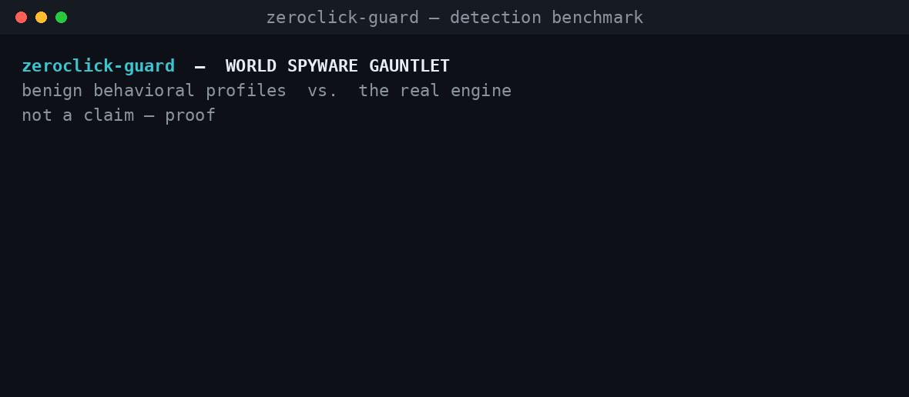
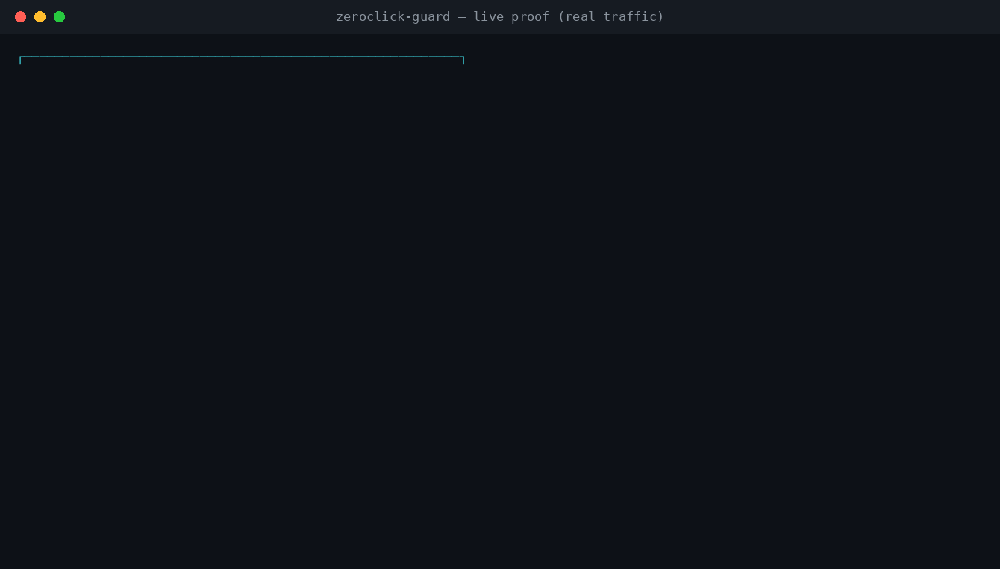
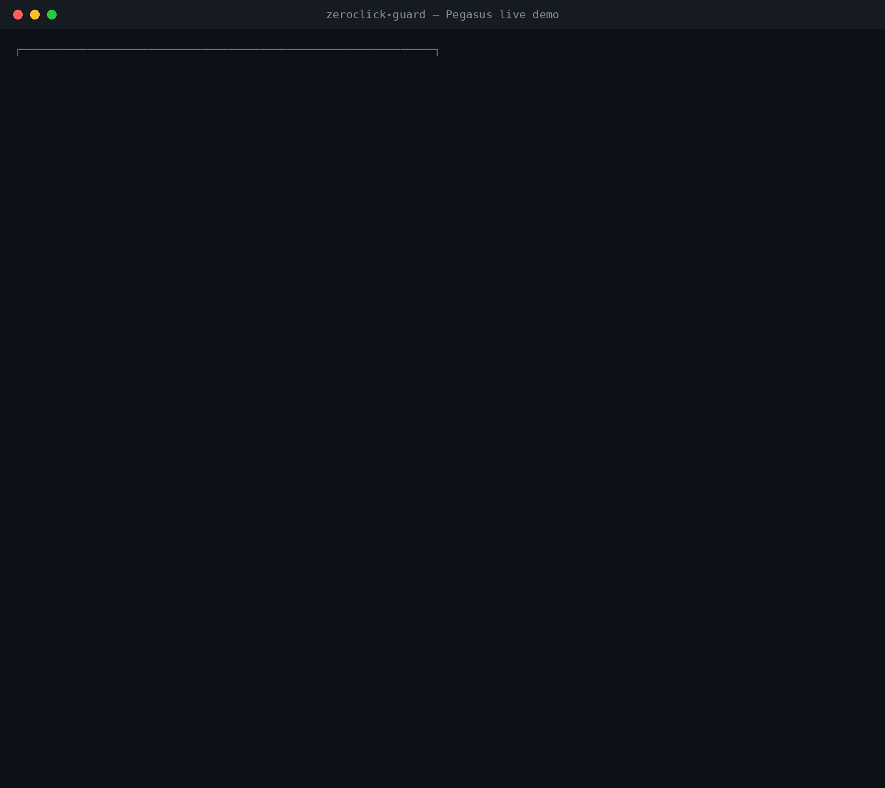

<div align="center">

# ⚡ zeroclick-guard

**An anti-spyware & zero-click shield for Android — and desktop.**

Detects and cuts off spyware behavior (C2 connections, data exfiltration, permission
abuse) right on the device. Rule-based, deterministic, auditable.
No AI. No cloud. Full privacy.

[](https://github.com/lyxadev/zeroclick-guard/actions/workflows/ci.yml)
[](LICENSE)
[](#status)
[](core/)

</div>

---

<div align="center">



*The real engine vs. the behavioral profiles of 7 well-known spyware families. Not a claim — proof you can re-run.*

</div>

> ### 🚧 Status
> **Early development.** The core detection engine **already works end-to-end and is
> demoable** (see below). Android integration (VpnService) is in progress — see the
> [Roadmap](docs/ROADMAP.md). We only claim what actually runs.

## What this is — and what we do NOT promise

Advanced spyware (Pegasus-class) often arrives via a **zero-click** attack: the victim does
not have to tap anything — an app like WhatsApp automatically processes malicious media, and
the exploit runs inside that process.

**Honest from the start:** on Android without root, **no** software can *prevent* the
zero-click exploit itself — it happens inside another app's process, sealed off by Android.
Anyone claiming 100% prevention is lying.

What **is** possible — and what zeroclick-guard does — is to **catch the attack by its
behavioral traces** within seconds: spyware *must* phone home (C2), *must* send data out.
That is where we detect and **cut off** the connection.

> Analogy: we are not a bulletproof vest. We are the smoke detector and alarm that goes off
> loudly when something is burning, then shuts the door — so the victim **knows** and the
> damage is **stopped**. A spyware victim's biggest weakness is never realizing they were hit.

## How it works (in short)

```
   Observation sources           Detection engine (zcg-core)        Action
 ┌──────────────────┐          ┌───────────────────────────┐    ┌──────────────┐
 │ Android VpnService│   ───▶   │  rules + score + IoC       │──▶ │ alert + cut   │
 │ (device traffic)  │          │  zero-click correlation    │    │ off + guidance │
 │ pcap / simulator  │          │  beacon & exfil detection  │    └──────────────┘
 └──────────────────┘          └───────────────────────────┘
```

The core engine is **platform-agnostic**: it only eats a stream of *observations* (network
connections, inbound media, permissions). Today it runs on desktop; Android integration
feeds the same engine. **The engine used in the demo is the engine used in the product.**
Nothing is faked.

### What gets detected

| Rule | Signal | Score |
|---|---|---|
| `ioc_match` | Connection to a known-bad IP/domain | +50 |
| `zeroclick_followup` | **New** external connection shortly after inbound media | +40 |
| `accessibility_abuse` | Accessibility + sensitive permissions (eavesdropping) | +35 |
| `beaconing` | Highly regular periodic connections (phoning home) | +30 |
| `exfil_volume` | Outbound data spike from a background app | +25 |
| `unknown_destination` | Background app → unknown external destination | +15 |

Scores accumulate per app → verdict: `SAFE` · `WATCH` · `SUSPICIOUS` · `LIKELY SPYWARE` ·
`DANGER`. Details: [docs/DETECTION.md](docs/DETECTION.md).

## Try it yourself (~1 minute)

Needs [Rust](https://rustup.rs). Clone, then:

```bash
cargo build --workspace
```

Run the **benign** attack simulator and pipe it into the engine:

```bash
./target/debug/zcg-testlab zeroclick | ./target/debug/zcg --ioc examples/ioc-testlab.json
```

Output (the zero-click attack is caught, then given a verdict):

```
  ├─ [00:40.000] IoC list match (+50)  com.whatsapp
  │    Connection to a known malicious indicator: 203.0.113.50 ...
  ├─ [00:40.000] Zero-click follow-up pattern (+40)  com.whatsapp
  │    'com.whatsapp' received media, then 30s later opened a new connection to
  │    203.0.113.50 (external, never contacted before). Classic zero-click pattern.
  ├─ [00:50.000] Outbound data spike (+25)  com.whatsapp

══════════ VERDICT SUMMARY ══════════
  com.whatsapp             score 130  DANGER → CUT OFF & QUARANTINED
```

### 🔥 The "brutal" demo (live, for recording)

A coordinated, APT-style attack — **zero-click in two messengers + spyware disguised as a
"system update"** — hits one victim at once and is neutralized **live** with cinematic tempo:

```bash
./scripts/demo.sh brutal        # or: zcg-testlab brutal | zcg --ioc ... --replay
```

The attack unfolds on screen, then is cut off one by one:

```
 ⛔ com.system.update.helper DANGER — CONNECTION CUT & QUARANTINED (score 105)
 ⛔ com.whatsapp             DANGER — CONNECTION CUT & QUARANTINED (score 105)
 ⛔ org.telegram.messenger   DANGER — CONNECTION CUT & QUARANTINED (score 105)
 ⛔ THREAT NEUTRALIZED — 3 app(s) cut off & quarantined
```

> Still honest: `--replay` only controls the **display tempo** so it is watchable. Every
> alert, score, and cutoff comes from the **exact same engine** as the product.

### 🌍 Proof: the World Spyware Gauntlet

Run the behavioral profiles of real spyware families through the engine and get a scoreboard:

```bash
cargo build --workspace --release
./scripts/benchmark.sh
```

```
  ● DETECTED  Pegasus (NSO Group)      zero-click via messenger   score 160 CRITICAL
  ● DETECTED  Operation Triangulation  zero-click via iMessage    score 160 CRITICAL
  ● DETECTED  Predator (Cytrox)        installed, full capture    score 160 CRITICAL
  ● DETECTED  FinFisher / FinSpy       installed, mic + camera    score 160 CRITICAL
  ● DETECTED  Hermit (RCS Lab)         installed via SMS lure     score 160 CRITICAL
  ● DETECTED  Chrysaor                 accessibility keylogging   score 160 CRITICAL
  ● DETECTED  Commercial stalkerware   hidden tracker app         score 160 CRITICAL
  RESULT: 7/7 families DETECTED — 0 missed.
```

> **What this proves, honestly.** Each family name is a **behavioral profile** inspired by
> public reporting — a *benign* simulation using RFC 5737 test endpoints, **not** the real
> malware. The proof is that the engine flags the documented *behavior* (C2 beaconing,
> exfiltration, zero-click follow-up, Accessibility abuse) **reproducibly** — and it still
> does so with the IoC list empty, i.e. purely from behavior. It is **not** a guarantee
> against a live, evolving implant; it is evidence the detection logic works and is not just
> theory. This same gauntlet runs in [CI](.github/workflows/ci.yml) on every push.

### 🧪 Verified prevention on REAL traffic (not just "QUARANTINED")

The gauntlet feeds *scripted* observations. `zcg-proof` does not — it runs real traffic
through an enforcement gateway, **blocks** the threat, and **independently verifies** the
block:

```bash
./target/release/zcg-proof     # ~3s; exits 0 only if blocking is verified
```



A benign process opens **real TCP connections** (incl. a real 3 MB transfer) through a guard
gateway — the same role Android's VpnService plays. When the engine flags it, the guard
**stops forwarding** that app. Then a controlled C2 server, **counting bytes itself**, proves
the outcome:

```
Controlled C2 — bytes received AFTER block:  0 bytes  ✓
Post-block connection attempts: 100  → 100 blocked / 0 forwarded  ✓
Normal app after block: 912 bytes delivered  ✓ (NOT blocked)   ← no false positive
```

"0 bytes after block" is the destination's own tally, not our claim. A machine-readable
record lands in `target/zcg-evidence.json`. See [docs/PROOF.md](docs/PROOF.md) for the full
real-vs-provided breakdown and honest limits (full OS-level anti-bypass is on-device, Level 3).

### 🕵️ Watch a Pegasus-style attack get neutralized

A narrated, live demo of the Pegasus kill chain — and where a network defender can actually
act:

```bash
./target/release/zcg-pegasus     # a few seconds
```



The implant tries to exfiltrate your photos, messages, a mic recording, your location and
passwords. Every attempt is **dropped at the tap** before it reaches the controlled C2, which
counts bytes itself:

```
Bytes of your data that reached the Pegasus C2:   0 bytes  ✓
Exfiltration attempts to the C2: 101 → 101 blocked / 0 delivered  ✓
Your normal messaging (still works): 12,000 bytes delivered  ✓
⛔ PEGASUS NEUTRALIZED — 0 bytes of your data left the device
```

> Honest, and said on screen: the zero-click **exploit** is not prevented (it cannot be,
> without root). What is stopped is the **theft** — and the victim is alerted, which Pegasus
> victims almost never are. It is a benign simulation: no real exploit or spyware, real
> sockets and a real block.

Compare with **normal** behavior (should raise no alarm):

```bash
./target/debug/zcg-testlab benign | ./target/debug/zcg --ioc examples/ioc-testlab.json
```

> **The simulator is benign.** `zcg-testlab` only *prints observation records* that mimic
> attack **behavior patterns**. There is no real exploit or spyware inside it — like a fire
> drill: the smoke is simulated, the alarm (the engine) is real. See [testlab/](testlab/).

## Project layout

```
zeroclick-guard/
├── core/      zcg-core   — detection engine (Rust library). The heart of the product.
├── cli/       zcg        — run the engine over observation files (demo & test).
├── testlab/   zcg-testlab — BENIGN behavior simulator for demos & testing.
├── proof/     zcg-proof  — Level-2 proof: feeds the engine REAL socket traffic.
├── pegasus/   zcg-pegasus — live, narrated Pegasus attack neutralized (verified).
├── examples/  sample IoC lists for the demos & the gauntlet.
├── scripts/   demo.sh · benchmark.sh · make_gif.py · make_proof_gif.py · make_pegasus_gif.py
└── docs/      DESIGN · DETECTION · PROOF · ROADMAP.
```

## Continuous integration

Every push runs [GitHub Actions](.github/workflows/ci.yml): format check, Clippy (with
warnings denied), unit tests — **and an attack simulation that asserts the real engine
catches every threat scenario and stays silent on benign traffic.** The attack being
neutralized is printed in the CI logs for anyone to read.

## Documentation

- 🚀 [docs/VISION.md](docs/VISION.md) — "Beyond Pegasus": the capability matrix, each row tied to its proof status.
- 📐 [docs/DESIGN.md](docs/DESIGN.md) — vision, architecture, what is realistic, honesty principles.
- 🔍 [docs/DETECTION.md](docs/DETECTION.md) — detection rules & scoring system, in full.
- 🧪 [docs/PROOF.md](docs/PROOF.md) — the proof ladder: scripted → real traffic + verified blocking → on-device.
- 🗺️ [docs/ROADMAP.md](docs/ROADMAP.md) — phased plan.

## License

[GPLv3](LICENSE). Free to use, study, and audit — and it stays open: anyone distributing a
modified version must open theirs too.

## Contact & official links

- 🌐 Website: **[lyxvo.ai](https://lyxvo.ai)**
- ✉️ Email: **halo@lyxvo.ai**
- 💻 Repository: [github.com/lyxadev/zeroclick-guard](https://github.com/lyxadev/zeroclick-guard)

For organizations (newsrooms, NGOs, law firms) or partnerships, reach us at the email above.

---

<div align="center"><sub>Built to help people who are targeted, in Indonesia and around the world.</sub></div>
