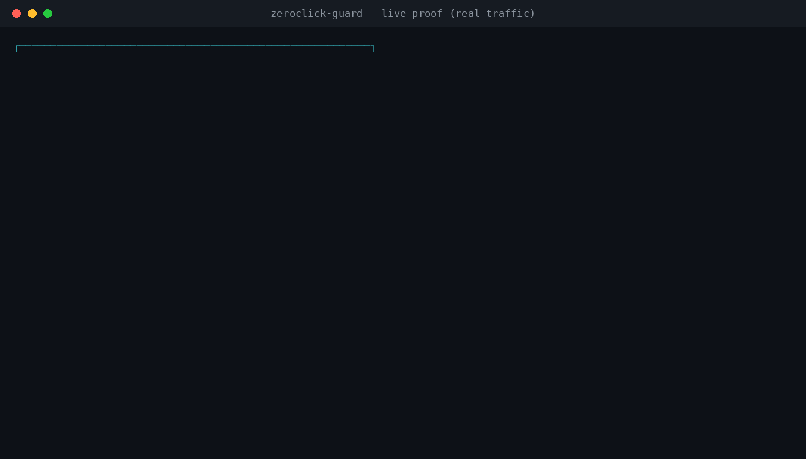

# Proof — from simulation to real traffic

A fair criticism of any detection tool is: *"nice theory, but does it work on real
traffic?"* This page is our answer. We treat proof as a ladder with three rungs, and we are
explicit about which rung each piece of evidence stands on.

| Level | What feeds the engine | Status |
|---|---|---|
| **1. Scripted observations** | Benign simulator emits observation records (JSONL) that mimic attack behavior. Reproducible, runs in CI. | ✅ done |
| **2. Real network traffic** | A benign process makes **actual TCP connections**; a sensor **measures the real sockets** (timing + byte volumes) and feeds the engine live. No scripted input. | ✅ done |
| **3. On-device (Android)** | A real `VpnService` captures a real app's traffic on a phone/emulator. | 🔭 planned |

The engine (`zcg-core`) is identical across all three rungs — only the **source of
observations** changes. That is the whole point: there are not two engines, one for demos
and one for reality.

## Level 1 — scripted observations (reproducible benchmark)

`zcg-testlab` prints observation records; `zcg` runs the engine over them. This is how the
[World Spyware Gauntlet](../README.md#-proof-the-world-spyware-gauntlet) and the unit tests
work. It proves the **detection logic** is correct and reproducible, and it runs in CI on
every push.

What it does **not** prove on its own: that the engine works on genuine traffic, because the
input numbers are generated by the simulator.

## Level 2 — real network traffic (`zcg-proof`)

This closes the Level-1 gap. Run it:

```bash
cargo build --workspace --release
./target/release/zcg-proof            # defaults: 6 beacons, 2.5s apart (~15s)
```



What actually happens:

1. A real local **TCP sink** is opened (a stand-in "C2 server").
2. A real, benign **client thread** actually `connect()`s to it on a cadence and `write()`s
   real bytes — including one large transfer (the "exfiltration").
3. The sink **measures each real socket**: the connect timestamp and the number of bytes
   actually received over the wire. Those genuine measurements become `Observation`s.
4. They are fed **live** into the same `zcg-core` engine, which flags the behavior and
   "cuts off" the app.

### What is real vs. provided

- **Real** (measured from the kernel's sockets, not hard-coded): the TCP connections, their
  timing (the beacon's "variation 0%" comes from actual `sleep`/`connect` timing), and the
  byte volumes (the ~2930 KB exfil is bytes genuinely sent over a socket).
- **Provided as metadata**: the app identity, sent in a one-line handshake. On Android this
  comes from the OS (per-UID) instead. And the sink's address is declared to the engine as a
  known indicator — which is honest here, because the sink *is* the stand-in C2 for the run.

### What this does and does not prove

- ✅ It proves the detection logic runs on **genuine network activity**, end to end, in real
  time — not on scripted numbers. The tool exits non-zero only if the real behavior is
  actually flagged.
- ❌ It is **not** a guarantee against a live, evolving implant using an unknown zero-day.
  Prevention of the initial exploit is impossible on a non-rooted device (see the
  [README](../README.md#what-this-is--and-what-we-do-not-promise)). Level 2 is about the
  *detection & cutoff* half — the half that is actually achievable.

## Level 3 — on-device (planned)

The final rung is a real Android `VpnService` observing a real app's outbound traffic on a
device or emulator, feeding the same engine. That is Phase 1b on the
[Roadmap](ROADMAP.md). When it lands, the same `zcg-core` will be judging real packets from
real apps — the strongest form of this proof.
